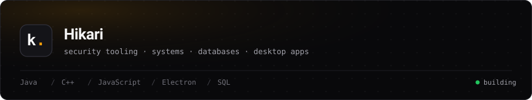

  

### Selected Projects

| Project | Focus | Stack |
| :--- | :--- | :--- |
| [**veritas**](https://github.com/HikariDevv/veritas) | Desktop screenshare forensics & live RAM scanner (Minecraft, GTA V/FiveM, Roblox) | `Java` `Electron` `Win32` |
| [**aegiscore**](https://github.com/HikariDevv/aegiscore) | PC security toolkit — malware scanner, persistence audit & AES-256 vault | `Java` |
| [**binshield**](https://github.com/HikariDevv/binshield) | Static PE (`.exe`/`.dll`) analyzer for packers, API imports & IOCs | `Java` |
| [**leakguard**](https://github.com/HikariDevv/leakguard) | High-speed secret scanner for catching leaked API keys & tokens | `C++17` |
| [**qrdrop**](https://github.com/HikariDevv/qrdrop) | CLI QR generator (PNG, SVG, terminal) with instant cloud share links | `Java` |
| [**lanbeam**](https://github.com/HikariDevv/lanbeam) | Local Wi-Fi file sharing from the terminal with QR pairing | `Java` |
| [**stegavault**](https://github.com/HikariDevv/stegavault) | AES-256-GCM encrypted file & text steganography inside PNG images | `Java` |

### Stack

  
  
  
  
  
  

