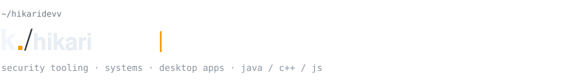

  

Building local-first security scanners, low-level utilities, and desktop tools in **Java**, **C++**, and **JavaScript**.

---

### Security & Forensics

- [**veritas**](https://github.com/HikariDevv/veritas) — Desktop screenshare scanner for Minecraft, GTA V/FiveM & Roblox with live Win32 RAM inspection, Replace Method checks, UserAssist since boot, and Recycle Bin recovery.
- [**aegiscore**](https://github.com/HikariDevv/aegiscore) — PC security toolkit in Java: malware & script scanner, startup persistence auditor, AES-256 quarantine vault, and temp cleanup.
- [**binshield**](https://github.com/HikariDevv/binshield) — Static PE (`.exe` / `.dll`) analyzer that flags packers, suspicious Windows API imports, and embedded IOCs.
- [**leakguard**](https://github.com/HikariDevv/leakguard) — Fast C++17 secret scanner for catching leaked API keys, tokens, and credentials before pushing to Git.

### Utilities

- [**qrdrop**](https://github.com/HikariDevv/qrdrop) — CLI QR generator (PNG, SVG, terminal) with instant cloud share links for photos, files, and URLs.
- [**lanbeam**](https://github.com/HikariDevv/lanbeam) — Local Wi-Fi file sharing from the terminal with QR pairing and a built-in browser transfer UI.
- [**stegavault**](https://github.com/HikariDevv/stegavault) — Hide AES-256-GCM encrypted files and messages inside PNG images using LSB steganography.

---

### Stack

`Java 17+` · `C++17` · `JavaScript` · `Electron` · `Node.js` · `SQL` · `Win32 API`

---

  

