  

 

<table>
  <tr>
    <td width="50%" valign="top">
      <h3><a href="https://github.com/HikariDevv/veritas">veritas</a></h3>
      
Desktop screenshare forensics suite for Minecraft, GTA V/FiveM &amp; Roblox — live Win32 RAM inspection, Replace Method, UserAssist since boot &amp; Recycle Bin recovery.

      <code>Java</code> · <code>Electron</code> · <code>Win32</code>
    </td>
    <td width="50%" valign="top">
      <h3><a href="https://github.com/HikariDevv/aegiscore">aegiscore</a></h3>
      
PC security toolkit in Java featuring a multithreaded malware &amp; script scanner, startup persistence auditor, AES-256 quarantine vault, and safe temp cleanup.

      <code>Java 17+</code> · <code>AES-256</code>
    </td>
  </tr>
  <tr>
    <td width="50%" valign="top">
      <h3><a href="https://github.com/HikariDevv/binshield">binshield</a></h3>
      
Static analyzer for Windows PE binaries (<code>.exe</code> / <code>.dll</code>) that detects packers, high-entropy sections, suspicious Windows API imports, and embedded IOCs.

      <code>Java</code> · <code>PE Analysis</code>
    </td>
    <td width="50%" valign="top">
      <h3><a href="https://github.com/HikariDevv/leakguard">leakguard</a></h3>
      
High-speed C++17 secret scanner designed to catch leaked API keys, tokens, and credentials across repositories before pushing to Git.

      <code>C++17</code> · <code>CLI</code>
    </td>
  </tr>
  <tr>
    <td width="50%" valign="top">
      <h3><a href="https://github.com/HikariDevv/qrdrop">qrdrop</a></h3>
      
CLI QR generator (PNG, SVG, terminal) with instant cloud share links for full-screen photos, files, and URLs.

      <code>Java</code> · <code>QR</code>
    </td>
    <td width="50%" valign="top">
      <h3><a href="https://github.com/HikariDevv/lanbeam">lanbeam</a> &amp; <a href="https://github.com/HikariDevv/stegavault">stegavault</a></h3>
      
Instant local Wi-Fi file sharing via QR pairing (<b>lanbeam</b>) and AES-256-GCM PNG steganography (<b>stegavault</b>).

      <code>Java</code> · <code>Networking</code> · <code>Crypto</code>
    </td>
  </tr>
</table>

 

  

 

  

